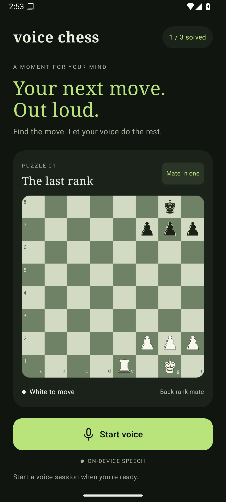

# Voice Chess

A native Android starter for solving chess puzzles with your voice. The app includes three local puzzles, a chessboard, spoken feedback, automatic opponent replies, a board-reading command, and saved puzzle completion progress.



## Stack

- **Kotlin + Jetpack Compose / Material 3** for the Android UI.
- **ViewModel + StateFlow** for puzzle and voice state.
- **Android SpeechRecognizer + TextToSpeech** for short spoken turns and audio feedback.
- **A pure Kotlin `core` module** for speech parsing, board representation, the puzzle catalog, and solution playback.
- **SharedPreferences** for the small set of completed puzzle IDs.

This keeps Android's microphone permissions, speech services, and lifecycle handling close to the platform, with the puzzle logic independently testable. No backend, API keys, or account setup is required.

Versions are pinned in `gradle/libs.versions.toml`: AGP 9.0.1, Kotlin 2.2.20, Compose BOM 2025.08.01, and Gradle 9.1.0. AGP 9 supplies Android Kotlin support; the Compose compiler plugin uses the same Kotlin version as the JVM core. See the [AGP documentation](https://developer.android.com/build/releases/agp-9-0-0-release-notes) and [Compose BOM documentation](https://developer.android.com/develop/ui/compose/bom).

## Run

1. Open this directory in an Android Studio version that supports AGP 9, and use JDK 17 for Gradle.
2. Install Android SDK Platform 36 and Build Tools 36.0.0 using SDK Manager.
3. Let Android Studio generate `local.properties`, or set `ANDROID_HOME` to your SDK directory.
4. Run the `app` configuration on an Android 8.0+ device (API 26+).

From the terminal:

```bash
./gradlew :core:test :app:assembleDebug :app:lintDebug
```

The debug APK is written to `app/build/outputs/apk/debug/app-debug.apk`. The starter has passed 21 core unit tests, a debug APK build, Android lint (with dependency update and target SDK advisories), and an Android 36 emulator smoke check for launch, typed solving, next-puzzle navigation, and completion persistence.

## Try it

Tap **Start voice**, allow microphone access, and wait for **LISTENING**. The first puzzle can be solved by saying **“e one to e eight”** or **“rook to e eight.”** The app speaks feedback, then listens for the next command. Say **“next puzzle”** to continue without touching the screen.

| Say | Result |
| --- | --- |
| `e one to e eight`, `e1 to e8`, `e1e8` | Move by source and destination |
| `rook to e eight`, `queen takes g seven` | Move by piece and destination |
| `echo one to echo eight` | Use phonetic file names (alpha–hotel) |
| `hint` | Hear a clue |
| `read board` | Hear every piece and square |
| `repeat` | Hear the puzzle objective again |
| `reset` | Restore the current puzzle |
| `next puzzle` | Advance through the local catalog |
| `help` | Hear supported commands |
| `stop` | Pause the voice session |

When a piece destination is ambiguous, the app asks for the source square. Recognition errors and incorrect moves leave the board untouched. The **Type a move** control accepts the same grammar and supports development on emulators without speech services.

## Speech behavior

Recognition prefers the on-device service on Android 12+ when available. If its English model is unavailable, the app can fall back to the installed speech service and announces the change. That service may process audio online. Offline puzzles do not guarantee offline speech. No audio files or transcripts are persisted by the app; the latest transcript is shown during the current screen session.

The microphone pauses during spoken feedback. Sessions stop after two minutes, repeated silence, leaving the app, or a `stop` command. Speech resources are destroyed when the activity's UI is disposed. See Android's [SpeechRecognizer reference](https://developer.android.com/reference/android/speech/SpeechRecognizer) for service availability, lifecycle requirements, and limitations on continuous recognition.

## Project layout

```text
app/src/main/java/com/voicechess/app/
  MainActivity.kt                  Permissions and lifecycle wiring
  PuzzleViewModel.kt               UI state and completion persistence
  ui/                             Compose screen, board, theme, preview
  voice/VoiceSessionController.kt  Recognition / TTS turn coordination
core/src/main/kotlin/com/voicechess/core/
  Chess.kt                        FEN board and move representation
  Puzzle.kt                       Repository interface and bundled puzzles
  VoiceCommand.kt                 Transcript-to-command parser
  PuzzleSession.kt                Solution checking and opponent replies
core/src/test/                     Parser, session, and board tests
```

## Scope and extension points

This skeleton checks **curated solution lines**. Its board movement geometry supports speech disambiguation and solution playback; it is not a complete legal-move generator. King safety, castling, en passant, alternate winning lines, arbitrary SAN notation, puzzle downloads, and an analysis engine are future work. The three bundled positions and their solution lines were independently checked for legality and final checkmate using python-chess.

Add new content through `PuzzleRepository`. Before supporting arbitrary imported positions, integrate a full chess rules library behind the core board API and represent alternative solution branches. The current tests cover spoken coordinates, homophones, ambiguity, wrong moves, promotions, reset/navigation, and multi-move reply playback. Microphone recognition and audio output should also be tested on a physical Android device.
